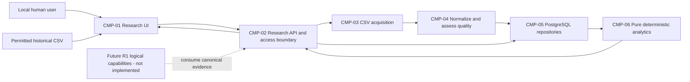

# Architecture Overview - VS-01 and R1 Evolution

**Version/date:** 0.1 - Proposed; 2026-11-01 (Asia/Calcutta).  
**Authority:** Human Step 2 architecture/design task; documentation only.  
**Baseline:** [REQ-BL-1.0](../01-requirements/REQUIREMENTS_BASELINE.md), annotated tag `requirements-v1.0`, commit `e10eef55fb21368e53dbe4599006b620cbb48566`. Tag and unchanged source content verified before authoring.  
**Status:** Architecture/design recommendations are Proposed. No baseline requirement status, maturity, priority, applicability or increment is changed. No implementation or spike is authorized.

## 1. Context and executable boundary

VS-01 is the **Gold/Silver ETF Research Dashboard**: configurable Indian ETF watchlist -> permitted real historical CSV -> validation/normalization -> PostgreSQL -> deterministic research indicators and supported comparisons -> provenance-aware charts.

It is an initial executable slice, not complete R1 or complete R1-A. Strategy signals, trade recommendations/plans, portfolio risk, paper trading, manual transactions, AI calls and scheduled reporting are outside this implementation boundary. Chart date ranges are not independent investment strategies. The R1-B allocation of baseline indicator/calculation requirements remains unchanged; Step 2 explores their research-only primitives early in a cross-cutting slice without claiming R1-B completion.

The configurable ₹20 lakh hypothetical reference remains a future portfolio input; VS-01 neither infers actual balances nor sizes trades. No broker credentials, broker connection, external execution or autonomous real trading.

See [detailed contracts](../03-design/VS-01_DETAILED_DESIGN.md), [acceptance plan](../03-design/VS-01_ACCEPTANCE_AND_TEST_PLAN.md) and [readiness/backlog](../04-planning/VS-01_IMPLEMENTATION_BACKLOG.md).

## 2. Recommended architecture - Proposed

Use a modular monolith: a React/TypeScript browser client calls one FastAPI application; that application owns one PostgreSQL database. Pure Python analytics do not access network, database, wall clock or LLMs directly. Provider-specific acquisition is translated into canonical contracts before persistence.

Separate logical responsibility from deployment: browser/API/database are runtime roles, not independently evolving business microservices. No queue, cache server, object store, scheduler service, vector database or orchestration platform is justified for bounded VS-01 CSV imports.

## 3. Responsibility and evolution map

| Component | Responsibility | VS-01 versus future |
| --- | --- | --- |
| CMP-01 Research UI | Watchlists, import/results, charts/comparison, quality and unavailable states | VS-01; no dead trading buttons. |
| CMP-02 Research API | Typed contracts, local access, orchestration, consistent errors and request IDs | VS-01; no authoritative calculations in browser/LLM. |
| CMP-03 Acquisition | Canonical CSV mapping; provider adapter boundary | CSV only now; network adapters future, individually qualified. |
| CMP-04 Normalize/quality | Identity, dates/units/basis, validation, duplicates, calendar/freshness assessments | VS-01; never infer missing prices/publication times. |
| CMP-05 Market persistence | Instruments, sources, imports/raw mapped rows, observations, quality, watchlists | VS-01; no holdings/order tables yet. |
| CMP-06 Quant analytics | SMA/EMA/RSI and price-only comparison primitives with input/version references | VS-01; research, not signals. |
| CMP-07 Strategy evaluation | Independent swing/tactical/strategic rules and model reconciliation | Future R1; no rule/weight selection now. |
| CMP-08 Risk | Portfolio limits and exposure gates | Future R1; policy remains unresolved. |
| CMP-09 Canonical planning | Versioned recommendations and broker-independent plans/renderings | Future R1; no plan becomes an order implicitly. |
| CMP-10 Paper execution | Explicit simulation lifecycle/fills/reservations | Future R1-B; cannot affect actual orders. |
| CMP-11 Manual transactions | User-reported actual orders/fills/corrections, unverified | Future R1-C; separate from paper. |
| CMP-12 Portfolio accounting | Mode-specific cash, positions, P&L/performance | Future R1; no simulated/actual combined track record. |
| CMP-13 AI research | Tool-mediated evidence interpretation and targeted questions | Future R1; read-only analytical contracts, no LLM calculation authority. |
| CMP-14 Reporting/scheduling | Daily intelligence/reassessment and qualified events | Future R1; not a VS-01 daemon. |

Do not scaffold future modules merely because they appear here. Keep domain interfaces separable inside one application; split deployment only if measured isolation/scaling requirements later justify it.

## 4. Technology assessment summary

All new choices require the [ADR package](ARCHITECTURE_DECISIONS.md); accepted upstream constraints stay authoritative.

| Layer | Recommendation | Main alternative/trade-off |
| --- | --- | --- |
| Backend | Existing Python/FastAPI direction; typed application/domain boundaries | A different backend is not justified against the baseline. |
| Frontend | React/TypeScript with Vite | Streamlit starts faster but gives less explicit UI/state/test separation; Next.js adds server responsibilities not needed locally. |
| Persistence | Existing PostgreSQL direction; proposed synchronous SQLAlchemy + psycopg and Alembic | Direct SQL has fewer abstractions but more hand-managed mapping/migrations; SQLite conflicts with accepted PostgreSQL direction and would not verify its constraints. |
| Analytics | Python Decimal for authoritative initial formulas; NumPy/pandas evaluated but deferred | NumPy/pandas can add vectorization later; SciPy/TA-Lib add no required capability for these simple recurrences. |
| Charts | Locally bundled Plotly.js React integration | Smaller line-chart libraries reduce bundle size but offer a different future financial-chart surface. |
| Testing | pytest; Vitest/React Testing Library; small Playwright Chromium suite | Avoid two competing frontend unit runners; do not test PostgreSQL behavior only against SQLite/mocks. |
| Local runtime | Proposed Docker Compose: UI, API and PostgreSQL plus one-shot migrations | Native setup may aid debugging but is not the canonical reproducibility proof. No Docker artifacts created now. |

Dependency versions/image digests must be pinned and compatibility-tested when implementation is authorized, not selected by unbounded latest installs. Existing installed tools and Docker daemon availability have not been certified. No packages or browsers were installed during design.

## 5. Data and execution invariants

1. Raw **mapped** provider field values, canonical observations, quality assessments and derived outputs are distinguishable.
2. Listings use explicit exchange + symbol and optional verified ISIN; no ticker/name guessing.
3. Every read uses an explicit source, daily frequency, price basis and revision. Never auto-merge vendors or raw/adjusted series.
4. Daily event date is not invented midnight event time. Missing provider publication time is null/unknown. Ingestion time cannot prove historical availability.
5. No forward fill, zero-fill, inferred holiday price or retrospective point-in-time eligibility.
6. Exact duplicate normalized observations do not change prices or dataset revision; conflicts are rejected pending a future approved correction workflow.
7. Indicators/comparisons carry evidence references and limitations; no trading threshold, probability, backtest or prediction is generated.
8. Retain the distinction between historical backtest, OOS/walk-forward, arriving-data forward paper, manual actual and benchmark evidence in future interfaces; none is produced in VS-01.
9. Proposed/Open requirements remain implementation blockers until a scoped human approval establishes their applicable behavior and criteria.

## 6. Local deployment, security and operations - Proposed

- Browser to loopback UI/API only; PostgreSQL stays on the private Compose network with persistent volume and no host database port by default. No cloud or public binding.
- One random local API token, supplied through uncommitted configuration. UI entry is kept in memory, not a frontend build variable, URL, localStorage or logs. Exact allowed origins and host checks complement authentication; CORS alone is not an authorization control.
- Import only bounded UTF-8 CSV; no archives, remote URLs, executables, formulas-as-code or dynamic mapping expressions. Preserve mapped market fields only, excluding unrelated account/PII columns.
- Errors are stable codes plus safe field/row references and request ID; never stack traces or raw file contents in responses.
- API startup verifies required configuration and migration revision. Liveness is distinct from database readiness. A migration failure prevents readiness.
- Explicit PostgreSQL backup and restoration exercise is part of the future slice acceptance; persistent storage is not a backup. Retention/rights policy must be approved.
- Structured logs: request/batch ID, outcome/counts/duration and version references. No secret, upload body or personal record logging.
- Reproducible local tests use isolated disposable test databases and controlled clocks, with no live provider calls. Failure artifacts and coverage are evidence, not financial performance.

Exact contracts, resource bounds and tests are in DC-02/03/07/09. No availability percentage, recovery-time objective or financial freshness threshold is invented.

## 7. Quality attributes and proportionate trade-offs

| Attribute | Design control | Acceptance evidence |
| --- | --- | --- |
| Correctness | Pure Decimal formulas/storage, explicit seeding/basis, independent rational references | VS01-T-11..16. |
| Integrity | Unique keys, per-instrument write serialization, atomic observation commit, immutable original provenance | VS01-T-04..08. |
| Explainability | Row/batch/source references, quality reasons, calculation fingerprint and parameters | VS01-T-09/10/17. |
| Usability | One dashboard workflow; loading/empty/error/unavailable states | VS01-T-18. |
| Security | Local access boundary, safe uploads and secrets separation | VS01-T-19/20. |
| Reproducibility | Locked dependencies, migrations, isolated tests, restart/restore proof | VS01-T-21..23. |
| Extensibility | Canonical source/domain interfaces; no future business module implementation yet | Contract review and no-scope-leak audit. |

Resource limits are technical safeguards proposed in DC-07, not investment rules. Measure performance on the documented test environment; do not claim an unmeasured SLA.

## 8. D-01 through D-16 preservation

| Decision | Architectural treatment |
| --- | --- |
| D-01/D-04 | Indian Gold/Silver ETF research; contextual/futures markets and future investments not silently implemented. |
| D-02 | Three independent strategies remain future R1 scope; chart periods do not satisfy them. |
| D-03 | No broker connection or real execution; future modes stay isolated. |
| D-05/D-11 | Canonical plans and GTT scenarios remain future boundaries, no current order endpoints. |
| D-06/D-15 | ₹20 lakh hypothetical/configurable reference retained; no actual account inferred. |
| D-07/D-13/D-16 | VS-01 dashboard only; AI/daily scheduled reports/events are later capabilities, with daily data not mislabeled live intelligence. |
| D-08 | Research indicators are not claimed to implement the independent strategy-model/reconciliation requirement. |
| D-09 | Deterministic calculations only; no ML implementation. |
| D-10 | Quality flags are not a signal-confidence probability or replacement for three-dimensional confidence. |
| D-12 | Capture provenance but mark imported history unverified for replay if availability/vintages are unknown. |
| D-14 | CSV-first canonical acquisition, future sources separately qualified. |

## 9. Readiness and human decision boundary

No capability is Ready for implementation today: applicable Proposed/Open parents and new ADR/design contracts are not approved. This does not require completing all six detailed REQ documents. The [planning review](../04-planning/VS-01_IMPLEMENTATION_BACKLOG.md#readiness) lists ten capability dispositions and a single scoped approval package.

External documentation supports technology feasibility, not approval or successful integration. References and provider limitations are recorded in the ADR file. No architecture/design file is committed or tagged under this task without separate authorization.
