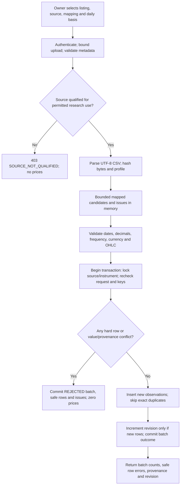
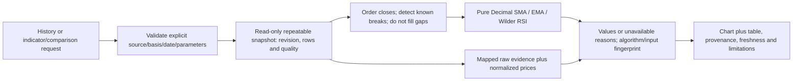
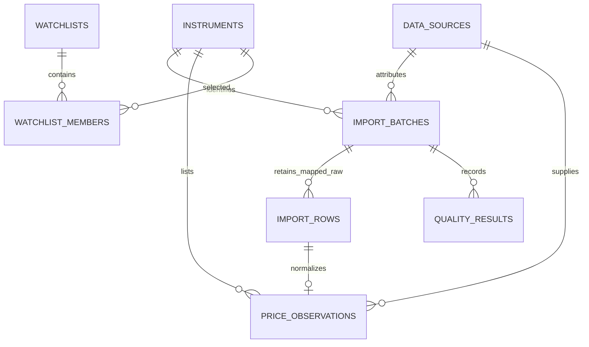

# Components and Data Flow - VS-01

**Version/date:** 0.1 - Proposed; 2026-11-01 (Asia/Calcutta).  
**Authority:** Human Step 2 architecture/design task; documentation only.  
**Baseline:** [REQ-BL-1.0](../01-requirements/REQUIREMENTS_BASELINE.md), annotated tag `requirements-v1.0`, commit `e10eef55fb21368e53dbe4599006b620cbb48566`. Tag and unchanged source content verified before authoring.  
**Status:** Architecture/design recommendations are Proposed. No baseline requirement status, maturity, priority, applicability or increment is changed. No implementation or spike is authorized.

## 1. Contract ownership and boundaries

Components are logical modules in the proposed monolith, not services to scaffold. [ADR-01..10](ARCHITECTURE_DECISIONS.md) are Proposed. The [detailed design](../03-design/VS-01_DETAILED_DESIGN.md) owns DC-01..09 contracts; [acceptance tests](../03-design/VS-01_ACCEPTANCE_AND_TEST_PLAN.md) verify the behaviors.

| Boundary | Input -> output | Owner/invariant |
| --- | --- | --- |
| UI -> API | Typed requests + local authorization -> typed response/error | CMP-01/02; no token in URL/build/log; browser does no financial calculations. |
| Acquisition -> normalize | Bounded mapped CSV rows + source/instrument/profile -> canonical candidates + row issues | CMP-03/04; preserve raw mapped values; no guessing provider identity/basis. |
| Normalize -> repository | Qualified candidates + batch/profile -> atomic accepted observations or rejection | CMP-04/05; financial rows never partially accepted. |
| Repository -> analytics | Explicit series/source/basis + revision + values/quality -> pure calculation input | CMP-05/06; no provider calls or wall clock in the engine. |
| Analytics -> API/UI | Versioned decimal outputs/unavailable reasons -> charts/tables | CMP-06/02/01; separate computed time from numerical determinism. |
| Future interfaces | Canonical evidence/analytical results -> approved strategy/risk/plan/paper/manual/AI responsibilities | Not implemented; current results cannot create orders. |

## 2. Ingestion flow



One transaction commits either terminal rejected audit without prices, or accepted audit and all new observations. Only safe mapped market fields are retained; unrelated extra columns/account information are not persisted. A structurally rejected file can have only batch-level diagnostics, not retained unsafe rows.

Exact request-key replay returns the original result. A new request key with reordered or equivalent content creates a new audit attempt but does not duplicate normalized observations. The unique observation key and value/provenance hash, not only file bytes, govern financial idempotence.

## 3. Atomicity, concurrency and recovery

```mermaid
sequenceDiagram
    actor Owner
    participant UI as Research UI
    participant API as FastAPI application
    participant DB as PostgreSQL
    Owner->>UI: Select explicit CSV source and series
    UI->>API: Import with idempotency key and profile
    API->>API: Access, size and syntax checks
    API->>DB: Begin transaction; lock source/instrument; check key
    API->>DB: Persist safe mapped audit and recheck canonical keys
    alt Any hard error or conflicting duplicate
        API->>DB: Record rejection/issues; no observation insert
        API-->>UI: 422 validation or 409 conflict with batch ID
    else All candidates eligible
        API->>DB: Insert new rows; skip exact duplicates
        API->>DB: Update revision if changed; commit result
        API-->>UI: 201 outcome with counts and provenance
    end
    Owner->>UI: Retry request after response loss
    UI->>API: Same key and identical payload/profile
    API->>DB: Read stored batch
    API-->>UI: Original outcome/status; no new prices
```

- In one bounded transaction, hold a source-policy read lock and instrument write lock; recheck request identity and observation keys before insertion. Unique constraints are the final guard; no last-writer-wins.
- Terminal batch outcomes are ACCEPTED, NO_CHANGE, REJECTED or confirmed FAILED. There is no durable pending-job state or automatic background processor.
- Same request key with different content/profile is 409. A concurrent exact replay waits/resolves against the committed original; a unique-key race is handled by lookup, not exposed as an internal error.
- Recognized invalid input commits REJECTED audit with zero observations. Unexpected database errors roll back the transaction. Record a separate FAILED audit only if rollback is confirmed and storage permits it.
- Connection loss during commit can leave the outcome unknown: return IMPORT_OUTCOME_UNKNOWN with request key/ID, then look up/retry that same key. Never label it failed or create a replacement before resolving an accepted original.
- Successful request-key replay returns the original batch; rejected replay preserves its original error semantics. No queued retry service, source correction or overwrite is introduced.

## 4. Read and calculation flow



History pagination includes series/revision in an opaque cursor. A changed revision/policy requires 409 SNAPSHOT_CHANGED and reload; no claim of historical revision querying is made. One analytical request uses a consistent database snapshot; it cannot read old rows with a new revision counter.

EMA/RSI initialization uses the complete eligible prefix from the segment seed, not the visible chart start date. If the prefix exceeds the technical bound, return an explicit range-limit error rather than silently changing the seed. Calculation time is stamped by the application outside the pure engine.

No frontend, LLM or provider response becomes an authoritative formula result. Future strategy consumers must check algorithm, input revision, price basis and quality; VS-01 results are not trade recommendations.

## 5. Provenance chain and minimal relationships



An exact duplicate can retain an incoming audit row without creating another observation; the original accepted observation keeps its original row/batch provenance. Batch/row and source/instrument relationships are enforced by the DC-03 keys, not just diagram arrows.

| Time/identity | Meaning | Unknown handling |
| --- | --- | --- |
| event_date + precision | Exchange session date; an actual event timestamp only if supplied/qualified | Never synthesize midnight UTC or a close time. |
| provider_published_at | Provider's publication instant, when evidenced | Null plus reason if missing. |
| ingested_at | App received/accepted the row now | Does not prove historical publication/availability. |
| computed_at | Application generated this response/result | Separate from market time and excluded from numerical fingerprint. |
| source/profile/batch/row | Origin and normalization policy | Always attributable; unknown corporate-action basis is explicit. |
| algorithm/version/params/input fingerprint | Exact research calculation definition and data selection | No implicit lookback or trading interpretation. |

CSV history without original availability/vintage evidence is UNVERIFIED_FOR_REPLAY, even when it is valid for present-day descriptive research.

## 6. Error and presentation propagation

| Condition | Data/API result | UI behavior |
| --- | --- | --- |
| Invalid date/price/currency/frequency or known non-session date | Rejected import, safe row/code diagnostics; zero new observations | Actionable error summary and row inspection. |
| Exact duplicate / conflicting duplicate | Skip unchanged / reject conflict respectively | Show counts; never imply an overwrite occurred. |
| Missing expected session or known corporate-action break | Quality warning + indicator segment break; no invented bar | Chart gap and unavailable warm-up reason. |
| Unknown calendar/publication/corporate-action metadata | UNASSESSED/UNKNOWN flags | No green completeness/freshness badge or point-in-time claim. |
| Approved expected-session policy indicates lag | STALE with evidence and expected/actual dates | Warning; values remain labeled historical research under approved policy. |
| Source/basis mismatch or no common dates | Explicit comparison unavailable/422; no mixed-source synthetic series | Explain why comparison cannot be computed. |
| API/DB failure, unsafe origin, invalid token or oversized file | Safe typed error and request ID | Preserve current selection, allow deliberate retry; no raw internals. |

No rollback deletes unrelated data or rewrites the approved requirements. No application/database operations described here have been executed.
