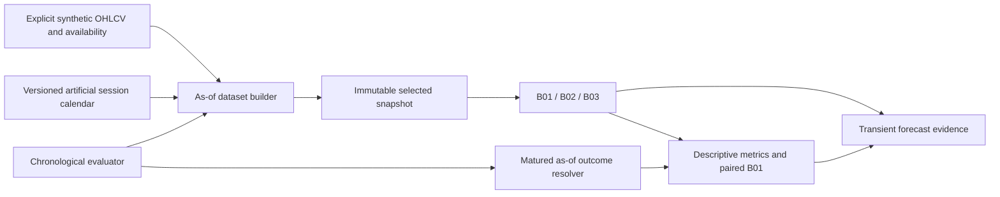

# Package 3 offline forecasting contracts and conventions

Date: 2026-11-06. Scoped authority: the Package 3 user request authorizes an offline synthetic forecasting harness, three baselines and chronological evaluation. All FRC-001..016 remain Proposed; this is not general forecasting/model approval or an immutable baseline change. Existing 38-file scope is captured by byte digests before implementation and preserved.

## Boundary and requirements gap review

Package 2 supplied only proposals; no dataset builder, model contracts, baseline or evaluator existed in source. This increment implements bounded synthetic-only modules without web routes, provider/credential loading, DB access, UI, scheduler or persistent ledger. Real source rights, PIT vintages, adjustments and forecasting-acceptance thresholds remain unresolved. Real-market calibration and prediction claims are outside scope. No deployment of an online forecasting service is required.

## Implementation conventions

Daily sessions only; supported horizons 1/5/20/60/120 count an explicitly supplied, versioned session calendar. Calendar publication must be known at every origin; session closes are aware timestamps whose exchange-local date matches the session. No inferred weekday/NSE calendar in the engine. Synthetic examples use an explicitly labeled artificial weekday/holiday calendar, not verified NSE dates.

Requests explicitly identify origin session, cutoff, identity, lookback in completed closing observations, horizon, model/configuration and strict quality policy. Data availability differs from observation close. Models receive only immutable selected snapshots whose required consecutive sessions were completed and available by cutoff; missing/duplicate/incomplete/unknown-quality inputs are rejected rather than filled. The selected origin must be the latest completed session at cutoff, preventing silently stale-origin substitution. Future calendar target close must be after cutoff and covered. Later/out-of-cutoff rows cannot enter model inputs or forecast fingerprints.

Only SYNTHETIC_TEST datasets with qualified synthetic metadata are accepted. Raw-basis windows crossing known corporate actions are rejected; adjusted inputs require an explicit policy/vintage, known and available at cutoff. No corporate-action adjustment, revision selection or real-data qualification is implemented. Unknown/future vintages fail eligibility. Calendar, quality, identity/basis, source references, availability and selected canonical OHLCV participate in snapshot hashes.

B01: predicted price=C_origin and return=0. Minimum one close. B02: arithmetic mean of L-1 one-session simple returns r=C_t/C_prev-1; price=C_origin*(1+mean(r))^h and return=(1+mean(r))^h-1. Minimum two closes. B03: sample variance of those returns with denominator n-1 (at least two returns/three closes), two-pass centered calculation; sigma=sqrt(variance); horizon volatility=sigma*sqrt(h), explicitly IID/unserially-correlated scaling. Optional annualization uses an explicit configured sessions/year; it is an assumption, not inferred from calendar days. Zero volatility is valid. B03 supplies no price path, directional probability or interval. These minima establish mathematical computability only; the earlier proposed 253-close research floor and validation/calibration support are not silently adopted as acceptance thresholds. Low support is warned and all synthetic evidence is non-market evidence.

Use isolated Decimal precision34, ROUND_HALF_EVEN; keep intermediate state unquantized, serialize derived values as fixed decimal strings to12 fractional places. B01 preserves the observed last price exactly rather than quantizing an uncalculated canonical value. Arithmetic exponent bounds are -96..96; unsupported overflow/quantization is rejected. Decimal sqrt is correctly rounded under that context, with independent higher-precision test references; no binary-float calculations/dependencies. Synthetic price bounds 1e-12..1e12 and <=34 significant digits; finite values, bounded lookback/calendar/origin counts. Overflow or unrepresentable derived quantization returns NUMERIC_UNSUPPORTED, never clipping to a price. This bounded statistical convention does not change existing analytics.

Walk-forward origins/cutoffs are explicit, chronological and bounded; each builds its own as-of context. No learned normalization, tuning or full-dataset statistics. Outcome evaluation has its own cutoff and requires complete, available h-session outcome paths on the same identity/basis. Pending/unavailable outcomes stay unscored with reasons. Support overlapping or deterministic nonoverlapping origin policies; report actual overlap and a disjoint-window count. Overlapping errors are descriptive dependent samples, not independent skill evidence; no confidence significance or calibrated probability is inferred.

MAE/RMSE use price errors; return MAE uses simple-return errors. Direction uses three classes (-,0,+), with zeros disclosed. B03 error compares horizon sigma to sqrt(sum(future one-session return squared)), explicitly a realized-volatility proxy, not observed latent volatility. Benchmark-relative improvement compares identical origin/target cases to B01; zero benchmark loss yields unavailable ratios. B01 cannot benchmark volatility. Probabilistic metrics remain unsupported. Empty samples return unavailable metrics, not zero accuracy.

All evidence stays in immutable in-memory contracts. Forecast/experiment fingerprints identify semantic inputs/config/model/calendar/numeric versions and exclude execution wall-clock time. Injected actual execution timestamps are recorded separately; historical replay cutoff is not fabricated creation time. Synthetic replay is separate from real OOS or forward paper evidence. CLI emits only synthetic summary/counts/metrics, never credentials, real OHLCV or raw responses. No external model adapter is implemented; only a provider-neutral Protocol/capability seam is specified.

## Trace and verification plan

FRC-001/002/003/004/005/006/009/010/011/013/015 -> forecast contracts/dataset/baselines/evaluation modules and independent synthetic tests. FRC-007/008/012/014/016 remain design-only beyond nullable/capability seams. REQ-03-001/002, REQ-06-001/002/003/005/018 supply existing determinism, separation, PIT and evidence obligations; REQ-06-006 and production forecasting policies remain open. Test malformed contracts, holidays, publication lag, gaps, duplicates, incomplete bars, adjusted vintages/actions, extrema, exact formulas, all horizons, append-future invariance, replay/overlap/maturity, paired metrics and no-I/O isolation. Run full existing regressions, build/container/security checks; compare existing RAM market data/provenance before and after without persisting prices.

## Implemented architecture and contract map

The modular monolith now contains these offline modules. They are deliberately not imported/registered by `app.main`; there are no web forecasting routes, ORM models, migrations or new services. Existing provider adapters, ingestion and indicators are byte-unchanged from Package 2. The existing historical DB contract has nullable publication times and unqualified source semantics; it cannot be implicitly promoted to a forecasting dataset. Current forecasting input is a separate, stricter synthetic contract and no real-data conversion adapter exists.



| File | Responsibility and contract |
| --- | --- |
| `backend/app/forecast_contracts.py` | Frozen strict schema models, explicit UTC/date/Decimal validation, synthetic identity/provenance, versioned calendar/dataset/request/snapshot/result, semantic SHA-256 and future model Protocol |
| `backend/app/forecast_dataset.py` | Validate source/identity/window/calendar/cutoff, reject unavailable/unclean context/actions, select only eligible observations; fingerprint the snapshot and assessment-visible dataset independently |
| `backend/app/forecast_baselines.py` | Immutable descriptors and bounded B01/B02/B03 dispatch; context34 arithmetic, sample-volatility estimator, explicit configuration and capabilities; never receives a full dataset |
| `backend/app/forecast_metrics.py` | Typed scoring cases, price/return/direction/realized-volatility-proxy errors; exact common-target benchmark joins, unavailable zero-denominator ratios and unsupported probabilistic metrics |
| `backend/app/forecast_evaluation.py` | Bounded chronological origins; fresh snapshot per model/origin; independent assessment cutoff; pending/unavailable outcomes and failure counts; overlap policy and immutable experiment evidence |
| `backend/app/forecast_demo.py` | Explicit generated synthetic example; actual execution clock at CLI boundary only; summary to stdout, no file writer or input-data connection |

Bounds: <=5000 calendar sessions/observations, <=500 corporate-action declarations, lookback1..1000 closes, <=200 origins and <=3 model runs per experiment; <=16 unique scalar settings with names<=128 and strings<=256 characters. Decimal input strings<=128 characters, <=34 significant digits, exponent and adjusted exponent within -96..96; finite positive OHLC within 1e-12..1e12, exact integer volume0..2^63-1. Prices may be supplied as Decimal or explicit decimal strings; float/bool price inputs are rejected. Underflow is trapped for arithmetic; nonpositive rounded forecast prices and unrepresentable outputs fail NUMERIC_UNSUPPORTED. No clipping, silent data correction or floating-point analytics.

Calendar identity/version/known time and source metadata are part of fingerprints. Equivalent numeric encodings and aware timezone representations normalize canonically; execution timestamps do not alter semantic forecast/experiment IDs. Evidence IDs also reference a separate execution ID, so replay events remain attributable. B01 preserves its observed last price exactly; other calculated outputs use fixed12-place decimal strings, including zero (not a binary float). All forecasts retain creation time distinct from historical cutoff.

### Evaluation details and intentional limits

`ALLOW_DEPENDENT` reports actual overlapping matured window pairs and maximum disjoint intervals; `REQUIRE_NONOVERLAPPING` rejects overlapping planned windows. Label windows use (origin,target] sessions, so adjacent windows sharing an origin/target price but no return intervals are disjoint. Counts are not confidence estimates. No label fitting/tuning/normalization occurs in these baselines, so no target labels enter training; a later fitted-model evaluator requires reviewed purging/embargo/nested selection beyond this harness.

B01 is computed on identical eligible origin/target/basis for each successful point case, even if omitted from displayed model runs. Relative improvement is 1-model_loss/benchmark_loss; negative values are allowed and zero benchmark loss makes the ratio unavailable. Price MAE reduction is baselineMAE-modelMAE. B03 cannot receive a price-performance rank from unsupported price outputs. RV proxy=sqrt(sum(one-session simple returns squared)) includes drift and is not a latent-volatility observation; the error is explicitly named a proxy error. Unsupported interval coverage/CRPS/calibration return null with reasons.

Input lookback is the number of closes, hence B02/B03 use L-1 returns. Minima1/2/3 are computational eligibility, not a replacement for Proposed statistical support floors. No statistical significance, prediction reliability, trained model, real OOS result or forward evidence is established. A candidate may perform worse than B01 on synthetic data; results are not selected or tuned to show improvement.

Only one declared immutable adjustment vintage per dataset is supported. Mixed basis, duplicate sessions/revisions, unknown adjustment policy or prices declared available before their adjustment vintage are rejected. Valid post-action raw segments can restart after the action; no prices are adjusted or backfilled. This is contract/eligibility behavior, not corporate-action service implementation or qualification of Dhan data.

The v1 model Protocol is a future adapter seam only; no dynamic model loader or external adapter is implemented. Current registry supports only B01/B02/B03 and no probabilistic capability. Interval schema is reserved; all baseline intervals/probabilities/calibration outputs remain unsupported. Future distribution/scenario/ML adapters need their own reviewed contract/capability/version extension, rights and evaluation evidence.

### Operating commands

From repository root, run the explicit synthetic example:

```powershell
uv run --frozen --no-dev --directory backend python -m app.forecast_demo
```

This prints a SYNTHETIC_HISTORICAL_REPLAY summary. It does not read `.env`, accept real-data files, invoke provider APIs, write a ledger or create forecasts in the dashboard. Do not interpret artificial calendar dates as NSE sessions. The synthetic series starts in2020 so its assessment cutoff precedes the current actual execution time; the CLI records the actual clock rather than inventing an origin-time creation record.

After building the existing backend image, an isolated smoke run uses no Compose environment, network, ports or volumes:

```powershell
docker run --rm --network none --entrypoint uv bullion-vs01-api run --frozen --no-dev python -m app.forecast_demo
```

No online API replacement is required for this offline module. Container verification checks that no Dhan/database/local-app credentials are present and that the image's installed dependencies match the freshly audited runtime manifest. The active API is kept running so the transient real cache/provenance is preserved.

### Governance disposition

Implementation scope is authorized by Package 3, not by silently changing FRC status. Requirements baseline/context/tag remain unchanged; all16 FRC statuses remain Proposed. This covers FRC-001/002/003/004/005 and bounded portions of006/009/010/011/013/015 using synthetic-only data. Calibration, scenarios, production visualization, external models, training and multi-factor acquisition remain unimplemented. A separate [Package 3 checkpoint](../04-planning/FORECASTING_PACKAGE_3_CHECKPOINT.md) records tests, exact file scope, source qualifications and next-phase recommendations.
