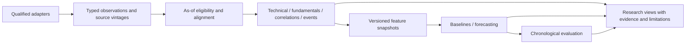

# Bullion research expansion assessment - 2026-11-06

Authority: owner's UX/fundamental/correlation/forecasting instruction. Package 1 is authorized for implementation. Packages 2-6 below are **proposals for review**, not approved mathematical methods, data permissions or baseline changes. No commit/tag/push is authorized. Immutable project context/REQ-BL-1.0/requirements-v1.0 remain unchanged; scoped ADR-01/02 architecture, ADR-06 mathematics and ADR-07 Plotly still govern. SQ-01/T-03 source/replay acceptance remains open.

## 1. Current-state and requirements gap review

Inspected main at fd5eee5fe4c36b98154c9750e2ff9e9ce437ded9, initially clean, all five project-context documents, scoped ADR register, detailed design, actual code/tests and Step 5E checkpoints. Earlier context describes discovery-time status; subsequent scoped approvals govern current implementation without rewriting that history.

| Area | Actual state | Gap / implication |
| --- | --- | --- |
| Architecture | React 19/TypeScript/Vite, FastAPI modular monolith, PostgreSQL/Compose, local bearer/Origin controls | Preserve; no microservice or new infrastructure. |
| Data | Four primary ETFs; Dhan daily/quotes/intraday/feed; bounded RAM and daily reconciliation | Source remains transient-owner-authorized/unqualified; persistent rights, universal timestamps/adjustments/replay still open. |
| Daily research | Plotly basic 4.2.0 line/overlay/comparison and separate RSI chart | One SMA period per view supports20/50/200 individually; three simultaneous SMA instances are not currently offered. |
| Intraday | Native SVG candles/volume, five intervals, completed-bar indicators,500-candle plot cap | Different renderer; live feed updates quote cards, not tick-built candles. Unified crosshair/zoom is future work. |
| Mathematics | Backend Decimal SMA, configurable EMA, Wilder RSI and price-only comparisons | Proposed indicators, fundamentals, macro correlation, events and forecasts are absent. No predictive capability claimed. |
| Presentation | Mixed100-row increments, history limit100, list-specific scrolling | Package 1 introduces one15-row presentation policy and explicit client paging with complete access. |
| Acceptance | Previous647 backend/29 frontend/six browser pass; owner UAT pending | New package verification is separate. Tests do not qualify sources or sign owner acceptance. |

The current cache has250 daily observations each for TATAGOLD/GOLDBEES,252 for SILVERBEES and an owner-extended542 for TATSILV (1294 total at inspection). This supports descriptive research, not validated multi-factor forecasting. A252-session return needs253 prices; the shorter series cannot form that label and 542 observations still offer only about two nonoverlapping252-session outcomes. Overlapping outcomes are not independent long-horizon samples. Do not fabricate older ETF history or substitute bullion history as actual ETF observations.

## 2. Five observation groups mapped to requirements

The request contains many subitems rather than five numbered observations. These five explicit groups cover them without inventing missing UAT reports.

| Group | Work mapping | Acceptance / authority |
| --- | --- | --- |
| O1 terminology | UX-01 / A1 / REQ-04-001 / ADR-02 | Bullion Workspace, Bullion Data Workspace and consistent unlock/open/lock text; unchanged routes/navigation. Authorized Package 1. Actual old heading was Data workbench. |
| O2 long tables/lists | UX-02/03 / A2 / existing pagination contracts | Shared measured 15-row viewport, sticky headers, keyboard scroll, responsive containment;15-row pages/increments; complete datasets reachable. Authorized Package 1. |
| O3 chart interaction | CHART-PROP / A3 / ADR-07 supplement | License/IST/gap/overlay/pane/accessibility/performance assessment and parity spike before replacement. Package 2 review. |
| O4 technical/fundamental depth | ANALYTICS-PROP / B-C / ADR-06 / REQ-03-007 extensions | Distinct complementary formulas and separate NAV/fund/bullion evidence. Packages 2-3 review. |
| O5 drivers/events/uncertainty | RESEARCH-PROP / D-F / D-08/09/10/12 and REQ-02/03/06 | Timestamp-safe return/change correlation, event vintages, exact currency attribution and benchmarked forecasts. Packages 4-6 review. |

These local work/proposal IDs do not amend baseline requirement status. Package 1 changes frontend presentation/tests/documentation only.

## 3. Technical indicators and framework

Preserve SMA20/50/200 choices, configurable EMA and Wilder RSI. Recommend **ATR and MACD first**, then prior-window Donchian; ADX and Bollinger as separately reviewed follow-ups. ATR adds range/volatility, MACD trend momentum, Donchian a breakout reference, ADX strength and Bollinger dispersion. Avoid compulsory overlapping overlays and correlated-indicator voting presented as confidence.

Defer Supertrend/ROC/OBV/VWAP: redundancy, qualified volume/adjustment prerequisites and VWAP trade-value semantics need assessment. Raw ETF-unit price ratios are not physical gold/silver ratios. Every proposed formula, parameter, required history, warm-up, timeframe, interpretation, limitation, test and validation rule is in [the analytical proposal](../03-design/RESEARCH_ANALYTICS_PROPOSAL.md).

Four research questions: trend (price/SMA/EMA/slope); strength (ADX plus DI direction); momentum/volatility (MACD/RSI and ATR/dispersion); breakout/consolidation (prior Donchian and range context). These are descriptive observations, not automatic buy/sell/reversal probabilities. Proposed contexts: intraday, short-term1-5 sessions, swing5-20, positional20-120 and long-term120-252; they do not revise approved strategy mandates.

## 4. ETF and underlying fundamentals

First usable view: all four verified ETF identities, source-linked issuer facts, effective dates, available NAV/market comparison, TER, AUM and liquidity evidence. Missing fields remain unavailable. NAV is per fund unit; market price is an exchange observation; iNAV is an indicative estimate with a separate timestamp. Yesterday's NAV cannot be presented as today's contemporaneous premium. No P/E/EPS or company-equity valuation applies.

| Metric | Definition / unit / method | Source / frequency | History and quality requirement |
| --- | --- | --- | --- |
| NAV | Reported net assets/units, INR/unit | AMC/qualified AMFI; daily | Exact scheme/ISIN/plan, valuation/publication dates and revisions; no assumed historical depth. |
| iNAV | Reported indicative INR/unit | AMC/exchange intraday estimate | Method/time/staleness; historical archives not assumed. |
| Premium/discount |100*(market/NAV-1), %; iNAV variant named separately | Derived synchronized prices/NAV | Same time/date/currency/share units; stale prior NAV labelled reference only. |
| TER | Reported annual expense ratio, %/year | AMC effective-date disclosures | Historical schedules/scope; not inferred from market-price underperformance. |
| Tracking difference | Cumulative NAV return minus named benchmark return, percentage points | Derived matched NAV/benchmark; issuer report separate | Same dates/distributions/actions/basis; market return is not NAV return. |
| Tracking error | sqrt(K)*sample SD(NAV daily return - benchmark daily return), annual % | Derived disclosed window; propose K252 | Window+1 compatible prices, n-1 variance, actual paired n; preserve issuer conventions separately. |
| AUM | Reported assets, INR with original crore/million unit | AMC dated factsheet/periodic disclosure | Scheme/as-of/archive;1 crore=10^7 INR; no daily interpolation. |
| Volume/turnover | Shares per bar/session; INR turnover separately | Dhan/NSE observations | Integer/date/session/auction scope; final/intraday differences explicit. |
| Bid-ask spread | ask-bid INR;100*(ask-bid)/mid %, mid=(ask+bid)/2 | Qualified simultaneous best quotes | Not collected by current adapter. Positive sizes, noncrossed/stale checks; no spread history assumed. |
| Liquidity | Median spread/turnover, zero-volume fraction and sample count | Derived specified windows | Source/session coverage; no invented capacity guarantee or composite score. |
| Holdings | Reported metal/cash/derivative weights and quantities | AMC monthly portfolio/disclosures | Units/as-of/sum/revision checks; not assumed100% physical metal. |
| Purity/metal per unit | Disclosed specification/quantity, sourced units | SID/KIM/custody/portfolio | Effective document; no assumed purity or fixed entitlement per ETF share. |
| Inception | Reported launch date | AMC scheme documents | Identity/corrections; no pre-inception ETF backfill. |
| Management/custodian | Reported entity/role/effective dates | SID/KIM/factsheet/custody disclosures | Versioned documentary facts, not an unsupported quality score. |

Gold hypotheses: central-bank/investment/jewelry demand, mine production, recycling, physical premiums, ETF flows, real rates and currencies. Silver adds industrial/solar/electronics demand, inventories, mine/recycling supply and industrial cycle. Tonnes/ounces must be explicit. Annual/quarterly quantities are not daily observations; preserve reference periods, publication lag and revisions. Narratives remain sourced hypotheses until tested.

## 5. Macro/correlation priorities

Initial slice: ETF returns, USD/INR (INR per USD), licensed ICE DXY, explicitly named US10-year real yield, and same-unit USD gold/silver ratio. Qualified underlying USD bullion prices are required for the ratio/decomposition. An unavailable DXY stays unavailable; an approved Fed broad-dollar proxy must have a different identity/label.

Next drivers: USD/JPY, nominal yields, Fed/BOJ/ECB policy changes; CPI/PCE and licensed historical consensus; copper/crude; manufacturing PMI; ETF flows/inventory; Indian bullion duties/domestic premiums. Use log returns/FX/index changes, basis-point yield changes and actual release surprises. Policy and demand releases are mixed-frequency facts, not repeated independent daily samples. PMI/consensus/futures/flow rights are separate dependencies.

Design Pearson/Spearman, rolling20/60/120/252-session correlations, lagged cross-correlation, beta, regime analysis and lead/lag exploration. Report sample n/window/cutoff/transform/lag/uncertainty and missing data. A US close after the NSE close is unavailable to that Indian-close forecast even on the same calendar date. Details and exact multiplicative currency decomposition are in the analytical proposal. Correlation is not causation.

## 6. Charting assessment

Actual build: Plotly basic 4.2.0 contributes about 1.22MB uncompressed in its lazy chunk. Daily charts are lines/overlays; native SVG supplies intraday candles/volume. The installed basic bundle is not a financial-trace bundle: general Plotly candlestick support is not already in our import. [Official bundle reference](https://github.com/plotly/plotly.js/blob/main/dist/README.md).

| Criterion | Plotly basic + existing SVG | Lightweight Charts 5.x candidate | Advanced Charts |
| --- | --- | --- | --- |
| React/TS | Existing imperative adapter/tests | Direct client-side TS library; thin local React create/update/remove adapter; no Python wrapper | JS/TS and custom datafeed, larger integration |
| Candles/daily/intraday | Daily line; SVG candles; finance bundle would need review | Native financial candles/bars/lines; daily dates and intraday times | Extensive financial chart surface |
| Volume/multiple series | SVG volume; Plotly comparisons | Histogram, multiple series/scales | Extensive built-ins |
| Indicators/panes | Backend values, separate RSI plot | Backend-value overlays and separate price/volume/RSI panes | Built-ins cannot silently replace approved backend calculations |
| Streaming | Current stream updates quote cards | Incremental normalized app-series updates; no provider credentials | Custom live datafeed; no market-data entitlement included |
| Crosshair/zoom/pan | Plotly hover/zoom; SVG lacks equivalent navigation; separate RSI sync not unified | Shared panes; app-level crosshair/time-range synchronization and explicit tests | Rich controls, restricted access |
| Mobile/performance | Existing responsive adapter/caps | Canvas/touch candidate; benchmark1k/10k/50k synthetic points and frame/heap use before claiming improvement | Unjustified complexity for private scope |
| IST/gaps/exactness | Existing labels/breaks/exact strings | No native timezone handling: preserve UTC identity, explicit IST mapping/labels/whitespace gaps; approximate chart coordinates, exact server hover/table | Datafeed calendars/timezones still our responsibility |
| License | Plotly MIT, already locked | Apache2.0 plus TradingView NOTICE/link attribution; pin reviewed version, avoid unneeded React wrapper dependencies | Proprietary and access-controlled; currently unavailable for personal projects |
| Maintenance/testing | Known pipeline; scientific plots still useful | Lifecycle/cleanup, resize, panes, crosshair, gap, stale/out-of-order and exact-value browser tests | Greater datafeed/license/test burden |

Sources: [setup/attribution](https://tradingview.github.io/lightweight-charts/docs), [panes](https://tradingview.github.io/lightweight-charts/docs/panes), [time zones](https://tradingview.github.io/lightweight-charts/docs/time-zones), [personal-use restriction](https://www.tradingview.com/free-charting-libraries/). Chart licenses do not license data. Display attribution/NOTICE/link in the local app; do not drop it because usage is private. No account/license request was made.

Recommend augmenting first with a direct Lightweight adapter **after review**, starting intraday candles/volume/RSI. Keep Plotly daily/comparison fallback. Migration: approve ADR-07 supplement/attribution/parity list; pin/audit; renderer-neutral exact-string contract; synthetic spike for IST/gaps/warm-up/crosshair/panes/accessibility/performance; permitted real-data test; enable one view behind a renderer choice; migrate daily/relative lines only after parity; preserve rollback. Plotly may still suit macro scatter/event diagnostics. No chart migration/dependency is introduced in Package 1.

## 7. Proposed architecture

One FastAPI/PostgreSQL deployment and React UI. Reuse acquisition/catalog/budgets, source qualification, canonical OHLCV, Decimal analytics, authentication and dashboard state. Existing market/reference/technical/dashboard components are extended, not duplicated. Future logical modules: fundamentals, macro acquisition, as-of correlation, events, forecasting and evaluation; no scaffolding or separate services now.

Proposed contracts/table candidates and cutoffs are in [the analytical proposal](../03-design/RESEARCH_ANALYTICS_PROPOSAL.md). Persistent data needs explicit dataset retention permission first; RAM is not a workaround if even caching is restricted. Package 1 adds no migration, credentials, scheduler or forecast implementation.

## 8. Provider/rights assessment

Documentation checked2026-11-06. Coverage/access statements are not dataset qualification. No accounts/keys created, no macro/fundamental ingestion or new authenticated service setup.

| Provider / evidence | Access, frequency and history | Qualification disposition |
| --- | --- | --- |
| Existing Dhan | Approved ETF daily/quote/intraday/feed paths; listing-specific history | Existing transient standing authority only; not evidence of NAV/macro/news/ML/retention rights. |
| [Tata NAV/iNAV](https://www.tatamutualfund.com/etf-nav), [scheme documents](https://www.tatamutualfund.com/mutual-funds/tata-gold-exchange-traded-fund-direct-growth) | Official display and documents; daily NAV, indicative updates, periodic factsheets/portfolios | Primary Tata candidate. Verify each ISIN/metric date, archive depth, automation and retention. No stable public API assumed. |
| [Nippon Gold BeES](https://mf.nipponindiaim.com/FundsAndPerformance/Pages/NipponIndia-ETF-Gold-BeES.aspx) and Silver issuer disclosures | Official NAV/performance/SID/portfolio; field-specific periods | Public snapshots mix dates. Verify Silver identity/source page and historical terms separately; no undocumented endpoint scraping. |
| NSE / AMFI official reports | Exchange prices/listings versus fund NAV; product-specific reports/exports | Dataset automation/license not established. AMFI history page inaccessible through this review tool; API/coverage not verified. Prefer issuer evidence first. |
| [RBI statistics](https://www.rbi.org.in/Scripts/Statistics.aspx), [Fed DDP](https://www.federalreserve.gov/datadownload/) | FX/policy/economic releases/exports, series-specific history and publication lags | Direct-publisher candidates. No unrestricted RBI API claim. H.10 INR/USD is not necessarily a synchronized NSE-close tradable FX observation. |
| [US Treasury XML](https://home.treasury.gov/treasury-daily-interest-rate-xml-feed) | Documented GET/XML and CSV views; daily nominal curves since 1990, real curves since 2003 | First real-yield candidate after terms/method/calendar review. Latest historical daily values are not proof of point-in-time revision history. |
| [FRED API](https://fred.stlouisfed.org/docs/api/fred/), [keys](https://fred.stlouisfed.org/docs/api/api_key.html), [vintages](https://fred.stlouisfed.org/docs/api/fred/realtime_period.html) | Key-based series API; ALFRED date-level vintages; coverage varies | **Conditional, not default forecast storage**: current [API terms](https://fred.stlouisfed.org/legal/) include storage/caching/database and software/AI/ML development/training restrictions. Clarify intended use before connection. Personal research/key access is not blanket retention/training permission. Prefer separately qualified direct-publisher delivery. Date vintages do not establish exact intraday release times. |
| [ICE currency indices](https://www.ice.com/fixed-income-data-services/index-solutions/currency-indices) | Authoritative DXY identity; data delivery/history by service contract | No DXY entitlement established by Dhan or a public page. Obtain history/derived-use/retention terms; no free API assumed. |
| [BOJ launch](https://www.boj.or.jp/en/statistics/outline/notice_2026/not260218a.htm), [manual](https://www.stat-search.boj.or.jp/info/api_manual_en.pdf) | Official API launched 18Feb2026; JSON/CSV statistical history/metadata | Verify series, use notice and request bounds. Policy releases are distinct from market-implied rate expectations. |
| [ECB API docs](https://data.ecb.europa.eu/help/api/overview) | Official structured-access candidate | Returned503 during review; current interface/limits/terms/history require verification before adapter approval. |
| [BLS](https://www.bls.gov/developers/), [BEA](https://www.bea.gov/resources/for-developers) | CPI/jobs API; PCE API/exports/RSS; monthly/quarterly revisions | API registration/ranges and attribution need verification. Latest-value APIs do not guarantee first-release vintages or historical consensus. |
| [WGC demand](https://www.gold.org/goldhub/research/gold-demand-trends), [terms](https://www.gold.org/terms-and-conditions) | Quarterly demand/supply plus periodic flow research | Industry research authority, not unrestricted data. Embedded LBMA/CME/ICE material has separate restrictions; do not turn Goldhub prices into our independent forecasting feed. |
| [Silver Institute](https://silverinstitute.org/all-world-silver-surveys/) | Annual surveys since 1990, archived PDFs | No production API or machine-use/retention grant established; publication lags/revisions matter. |
| [LBMA](https://www.lbma.org.uk/prices-and-data/lbma-gold-price), relevant exchanges | Benchmark/futures/settlement/inventory products | Qualify delivery/downstream rights separately. Fixing times differ; futures require contract/roll methodology, not spot relabelling. |
| Official Fed/BOJ/ECB/RBI/BLS/BEA/CBIC releases | Decisions, statistics and duty effective notices; HTML/PDF/RSS where documented | Minimal cited event facts first. Full-text news/consensus/ML/redistribution rights are distinct; no news-feed entitlement assumed. |

Recommended order: Dhan for ETF market data; AMC disclosures for fund facts/NAV; direct Treasury/Fed/RBI for initial macro candidates after review; licensed ICE/vendor for DXY and a qualified same-unit bullion source. WGC/Silver Institute provide periodic context. FRED remains conditional despite useful vintage tooling. There is no one-subscription solution.

Before acquisition, record provider/dataset/identifier, license/evidence/version; retrieval/storage/display/derived analysis/backup/ML/redistribution grants separately; credential owner; frequency/calendar/history; units/currency/basis; reference/valuation/event/publication/retrieval/vintage times; revisions/finality; quality rules/retention expiry/provenance. Public access is not permission. No emails/support requests were sent.

## 9. Forecast methodology and validation

Deterministic research/scenarios/event studies first, then separately approved baselines. Configurable targets1/5/20/60/120/252 **NSE sessions**, anchored to an explicitly available qualified close/data cutoff; keep price-only and total returns distinct. Dhan T-1 publication means today's final close cannot be assumed available at a same-day forecast origin. No invented histories, consensus or timestamps.

Begin with no-change/random-walk and expanding historical-return distributions, then volatility/regularized regression/simple regime candidates if independent data is adequate. ML requires sufficient qualified multi-year inputs and demonstrated out-of-sample value. A reviewed numeric-solver/dependency decision is necessary before floating-point estimation outside the canonical Decimal pipeline.

Outputs: distribution/quantiles, calibrated positive/threshold probability, downside/volatility, scenario assumptions, horizon/cutoff/model/dataset versions, supporting/contradicting evidence and separate data quality. Insufficient data means unavailable, not50% or invented confidence. Use chronological rolling/expanding train/validation/test; purge overlapping horizon labels across splits, embargo publication uncertainty, fit transforms only inside training, nested walk-forward tuning and untouched final holdout. Never shuffle time series. Report mature labels/independent windows, block-bootstrap uncertainty, regime results and costs/spreads for any later strategy study.

Point forecasts: MAE/RMSE relative to no-change/history. Direction: discrimination (ROC/PR when appropriate) separately from calibration/Brier/log loss. Distributions: CRPS or pinball/quantile scores plus interval coverage/width. Report multiple-testing/selection burden across horizons/drivers. Review sample/regime requirements and baseline-improvement thresholds before experiments. No claim that an in-sample fit is predictive. Full specification: analytical proposal.

## 10. Prioritized backlog

| Order / package | Deliverable | Review/dependency gate |
| --- | --- | --- |
|1 / Package 1 | Workspace labels/shared 15-row presentation | Authorized; verified in package checkpoint; no math/dependency changes. |
|2.1 | Chart parity/attribution spike | ADR-07 supplement, IST/gap/exactness/accessibility/performance parity; retain existing renderers. |
|2.2 | ATR + MACD vertical slice | ADR-06 seeds/finality/conventions, independent reference fixtures and traceability. |
|2.3 | Prior Donchian, then ADX/Bollinger if distinct value | Reuse TR/smoothing; reviewed presets; no indicator-vote probabilities. |
|3.1 | Typed fund facts/verified issuer view for four ETFs | Rights/ISIN/date contracts; no placeholders; retention/schema approval if storing. |
|3.2 | Premium/TD/TE/liquidity | Synchronized NAV/benchmark/bid-ask availability and basis/volume review. |
|4.1 | ETF/FX/DXY/real-yield/gold-silver slice | Rights/units/bullion/calendar/cutoff qualification; unavailable drivers stay unavailable. |
|4.2 | Correlation/beta/lags/currency attribution | As-of/missing/sample/uncertainty/multiple-testing policies. |
|5.1 | Small Fed/CPI/RBI/duty event view | Actual publication/revisions; consensus absent -> surprise unavailable. |
|5.2 | Historical event windows | Qualified bars, contamination flags, pre-event-only benchmarks. |
|6.1 | Feature/evaluation manifests and no-change/history baselines | Retention/vintages/targets/cutoffs/reproducibility review. |
|6.2 | Simple calibrated statistical candidates | Multi-year independent labels, purged walk-forward and held-out comparisons. |
|6.3 | ML only after evidence review | Added value, sufficient samples, training rights and numeric-method approval. |

Every implementation package requires backend/frontend/browser/build/Compose/dependency/credential checks, existing historical/live regression where permitted, a checkpoint and owner UAT. Tests do not equal acceptance.

## 11. Dependencies, risks and open decisions

Pending reviews: ADR-07 chart/attribution supplement; ADR-06 seeds/variance/zero-range conventions; simultaneous multi-SMA scope; per-source retention/ML grants; DXY vendor/bullion benchmark/calendar; NAV/benchmark synchronization and TD/TE; exact vintages/timestamp availability; forecast target/cutoff/cost/sample/evaluation policy; future statistical numerical conversion. These do not silently close SQ-01/T-03 or revise existing DC rules.

Main risks: short/young-ETF samples; overlapping labels and correlated evidence; US-close/fixing-time look-ahead; revised/latest macro histories; restrictive source storage/training terms; mixed NAV/market prices and daily/intraday close/volume differences; provisional contamination of final indicators. Data qualification matters more than indicator count. No microservices, account/holdings/funds access, orders, GTT or autonomous trading are proposed.

## 12. Recommended first increment and next authorization

Package 1 is implemented under this instruction: Bullion Workspace/Bullion Data Workspace; shared measured 15-row desktop viewport; sticky headers/accessibility/internal scrolling;15-row history/audit pages and research/compare/intraday reveal increments. Full access, filters/navigation and existing calculations remain. Mobile caps visible height and contains genuinely wide tables internally. Backend/API/provider/dependency behavior is unchanged.

Next recommended authorization: review **Package 2.1 chart parity spike and Package 2.2 ATR/MACD mathematical contracts**, rather than all later packages together. Progress dataset qualification as reviewed evidence; connections/storage need applicable approval. This proposal authorizes no accounts, dependencies, new analytics or provider ingestion. No commit/tag/push has been created.
